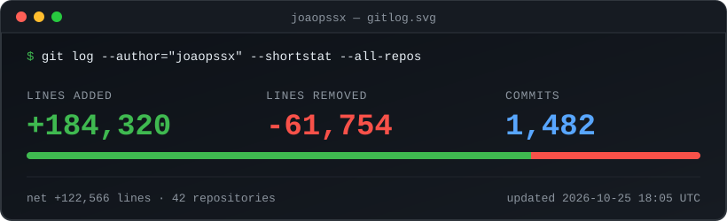

<div align="center">

# gitlog.svg

**A live stats card for your GitHub profile: lines added, lines removed and commits across all your repositories.**



</div>

---

## How it works

```
 you push to any repo
        │
        ▼
 gitlog-notify.yml (in that repo) ──► sends a "commit-pushed" event
                                              │
                                              ▼
                              gitlog.svg repo: .github/workflows/update.yml
                                              │  waits 45s, runs src/gitlog.py
                                              ▼
                              assets/gitlog.svg is regenerated and committed
                                              │
                                              ▼
                              your profile README shows the new card
```

- `src/gitlog.py` asks the GitHub API for the stats of every repository you own and sums them up. Pure Python standard library, no dependencies.
- A tiny workflow in each repository pings this repo on every push.
- An hourly schedule is kept as a safety net in case an event is lost.

## Setup

### 1. Two tokens (on purpose: each one has the smallest power possible)

| Token | Type | Permissions | Where it is stored |
|---|---|---|---|
| **READ** | Classic | `repo` | Secret `GITLOG_READ_TOKEN` in **this** repo only |
| **PING** | Fine-grained | Only repo `gitlog.svg` → **Contents: Read and write** | Secret `GITLOG_TOKEN` in **every** repo (the installer does it) |

The PING token is copied into many repositories, so it can only do one small thing. The READ token lives in a single place.

### 2. Add the READ token here

`Settings → Secrets and variables → Actions → New repository secret` → name `GITLOG_READ_TOKEN`.

Also enable `Settings → Actions → General → Workflow permissions → Read and write permissions`.

### 3. Install the notifier in all your repositories

```bash
gh auth login                                   # once
export GITLOG_TOKEN="<your PING token>"         # PowerShell: $env:GITLOG_TOKEN="..."
python src/install_notifiers.py --dry-run   # preview
python src/install_notifiers.py             # install
```

To undo everything: `python src/install_notifiers.py --remove`.

### 4. Show it on your profile

```markdown

```

## Good to know

- Only commits on each repository's **default branch** are counted (GitHub's own rule for this statistic).
- Forks and archived repositories are ignored by default (`INCLUDE_FORKS` in the workflow).
- After a push the card usually updates in 1–5 minutes: ~1 minute to run plus GitHub's image caching.
- Commits made with an email that is not linked to your GitHub account are not counted.

## Local test

```bash
python src/gitlog.py --demo    # writes a sample card to assets/gitlog.svg
```
